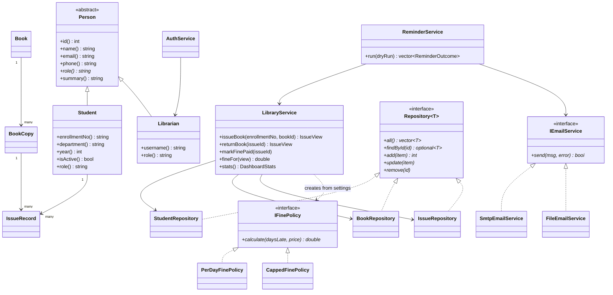

# Design notes

## Class diagram

## Request flow

`browser -> Crow route (main.cpp) -> LibraryService (rules) -> repositories (SQL) -> SQLite`

Routes never contain business rules, and repositories never contain business rules.
Rule violations are thrown as exceptions (`IssueLimitException`, `UnpaidFineException`, ...)
and `main.cpp` turns each into a JSON error with an HTTP status.

## Database

| Table | Columns |
|---|---|
| `students` | id, enrollment_no (unique), name, email, phone, department, year, status |
| `books` | id, title, author, isbn, category, price |
| `book_copies` | id, book_id, copy_no, status (`available` / `issued`) |
| `issues` | id, student_id, copy_id, issued_on, due_on, returned_on (empty while out), fine_amount, fine_paid |
| `librarians` | id, name, email, phone, username (unique), salt, password_hash |
| `settings` | key, value |
| `email_log` | id, issue_id, kind, sent_on, recipient, status |

Dates are stored as `YYYY-MM-DD` text so they sort and compare correctly.

## Rules in one place

- **Due date:** issue date + `loan_days`
- **Fine:** `IFinePolicy::calculate(daysLate, bookPrice)`, evaluated when the book is returned (and live for books still out)
- **Can a student borrow?** Active, under `max_books`, no unpaid fine, no overdue book, and a copy is on the shelf
- **Reminder kinds:** `due_in_N`, `due_today`, `overdue`. The first three go out once per loan; `overdue` repeats every `overdue_repeat_days`

## API

All routes except login need the session cookie.

| Method | Path | Purpose |
|---|---|---|
| POST | `/api/login`, `/api/logout` | Sign in / out |
| GET | `/api/me` | Current librarian + library name |
| GET | `/api/dashboard` | Overview numbers, overdue and due-soon lists |
| GET, POST | `/api/students` | List (`?q=`) / add |
| PUT, DELETE | `/api/students/<id>` | Edit / delete |
| GET, POST | `/api/books` | List (`?q=`) / add with copies |
| PUT, DELETE | `/api/books/<id>` | Edit (optionally `add_copies`) / delete |
| GET | `/api/issues?status=open\|returned\|all\|overdue\|fines&q=` | Loans |
| POST | `/api/issues` | Issue (`enrollment_no`, `book_id`) |
| POST | `/api/issues/<id>/return` | Return a book |
| POST | `/api/issues/<id>/pay` | Mark fine as paid |
| GET, PUT | `/api/settings` | Read / change settings |
| GET | `/api/emails` | Recent reminder log |
| POST | `/api/reminders/run` | Send now, or `{"dry_run": true}` to preview |

## Ideas for the viva

- *Why an interface for fines?* A new rule (say, a grace period) is a new class; `LibraryService` doesn't change.
- *Why `Repository<T>`?* One contract for storage; swapping SQLite for MySQL touches only the repository classes.
- *Why is the reminder job a separate executable?* It runs on a schedule even if the web server is down, and it shares all the same classes.
- *Why track `BookCopy` separately from `Book`?* Each physical copy has its own status, so we know exactly which copy a student holds.
